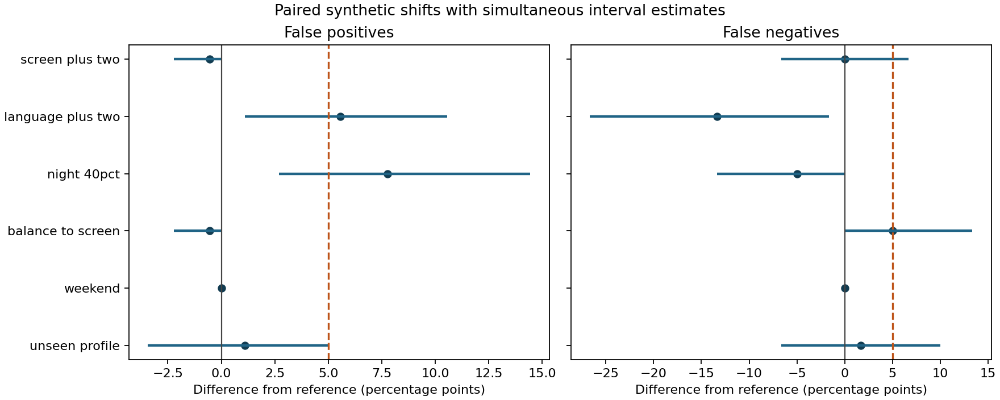
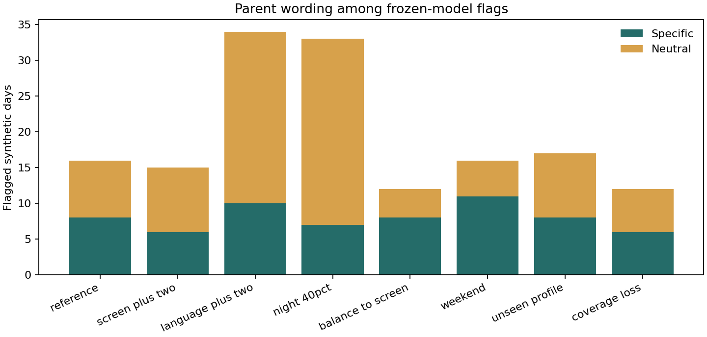

# Controlled frozen-model robustness replication results v1

The [preregistration](behavioral_robustness_preregistration_v1.md) and [hash lock](behavioral_robustness_preregistration_lock_v1.json) were saved before generating or scoring the replication. The experiment isolates six changes to the normalized daily inputs or activity profile and adds a monitoring-loss control. It reuses the frozen One-Class SVM, the saved cutoff, the exact three-group SHAP algorithm, original training backgrounds, and the v3 wording gate. The dataset is synthetic and distinct from previous evaluation rows.

Twenty matched profile pairs each contributed 12 shared day templates. Every arm evaluated 180 ordinary and 60 injected days. Each category had 20 scheduled cases per arm. Each template reused anomaly type, injected events and paired random draws. Seen profiles supplied normal examples to the saved model's original training pool. Their replication observations are new. Unseen profiles are fresh draws from the legacy profile generator, matched on age and used with new IDs. The detector receives neither IDs nor age. The profile comparison concerns ordinary behavior parameters. It cannot separate the role of each parameter or test the behavior of real children.

All intervals below use 10,000 matched-pair cluster resamples, retaining each pair's days and arms together. Model recall and false-negative rate use assessed positive cases. Coverage suppression is separate from false-negative counting. The cohort's fixed 25% positive share makes precision and F1 conditional on the experimental design. The adjusted paired intervals cover the twelve primary comparisons jointly at nominal 95% family coverage.

The regression suite covering Component 4 and existing Streamlit behavior reported **187 passed in 125.77 seconds**, exit code 0, including three new paired-design and metric tests.

## Detector results

| Arm | TP / FP / FN / TN | Precision | Recall | F1 | FPR | FNR | Coverage |
|---|---:|---:|---:|---:|---:|---:|---:|
| Reference | 14 / 2 / 46 / 178 | 87.5% | 23.3% | 36.8% | 1.1% | 76.7% | 100% |
| Screen +2 | 14 / 1 / 46 / 179 | 93.3% | 23.3% | 37.3% | 0.6% | 76.7% | 100% |
| Language +2 | 22 / 12 / 38 / 168 | 64.7% | 36.7% | 46.8% | 6.7% | 63.3% | 100% |
| Nighttime probability 40% | 17 / 16 / 43 / 164 | 51.5% | 28.3% | 36.6% | 8.9% | 71.7% | 100% |
| Shift balance toward screen | 11 / 1 / 49 / 179 | 91.7% | 18.3% | 30.6% | 0.6% | 81.7% | 100% |
| Weekend flag only | 14 / 2 / 46 / 178 | 87.5% | 23.3% | 36.8% | 1.1% | 76.7% | 100% |
| Unseen matched profile | 13 / 4 / 47 / 176 | 76.5% | 21.7% | 33.8% | 2.2% | 78.3% | 100% |
| Coverage loss | 10 / 2 / 35 / 133 | 83.3% | 22.2% | 35.1% | 1.5% | 77.8% | 75% |

Reference recall was 23.3% (95% cluster interval 13.3–33.3%), FPR 1.1% (0.0–3.3%), and F1 36.8% (23.5–48.8%). The reference passed the historical FPR point screen (3.03%) and failed the FNR screen (39.62%). The historical test used different synthetic labels and generation conditions. Its anchors are comparison points.

All 60 planned outage days had no score, flag or explanation. The unaffected 180 coverage-arm days retained the reference scores. Outages removed 15 scheduled positives, four of which were detected under complete coverage. The coverage arm detected 10/60 scheduled positives (16.7%) compared with the reference's 14/60 (23.3%). The 35 assessable false negatives and 15 unassessed positives describe different losses.

### Controlled differences and acceptance

Values are paired percentage-point changes with two-sided adjusted intervals in brackets. The declared screen requires each upper bound to stay at or below +5 points.

| Intervention | FPR change [adjusted interval] | FNR change [adjusted interval] | Endpoints passed |
|---|---:|---:|---:|
| Screen +2 | −0.56 [−2.22, 0.00] | 0.00 [−6.67, +6.67] | 1/2 |
| Language +2 | +5.56 [+1.11, +10.56] | −13.33 [−26.67, −1.67] | 1/2 |
| Nighttime probability 40% | +7.78 [+2.68, +14.44] | −5.00 [−13.33, 0.00] | 1/2 |
| Shift balance toward screen | −0.56 [−2.22, 0.00] | +5.00 [0.00, +13.33] | 1/2 |
| Weekend flag only | 0.00 [0.00, 0.00] | 0.00 [0.00, 0.00] | 2/2 |
| Unseen matched profile | +1.11 [−3.43, +5.00] | +1.67 [−6.67, +10.00] | 1/2 |

Only **7 of 12** endpoints met the preregistered margin. Language volume and nighttime reassignment changed 10 and 14 true negatives to false positives, respectively, without reversing any reference false positives. Adding screen events reversed one false positive without making a new one. It also exchanged one true positive and one false negative across affected cases, leaving net recall unchanged. This specific screen-volume contrast gives no evidence that a much larger shift, or its interaction with nighttime activity, would behave the same way.

Nighttime reassignment increased the realized nighttime count on 76/240 paired days. Rebalancing moved at least one ordinary language event on 143/240 days and preserved total daily count. Rebalancing lost three true positives, all language clusters. Weekend-only changed no binary flags. Its zero-width bootstrap intervals reflect zero observed transitions and carry no universal equivalence claim. The unseen profile comparison yielded two net extra false positives and one net extra missed positive. The FNR interval did not rule out a worsening greater than the margin.

### Recall by anomaly category

Here each cell is detected/assessed. All complete-coverage denominators are 20. The coverage arm scheduled 20 per category and assessed 13 screen, 17 language and 15 mixed cases.

| Arm | Screen clusters | Language clusters | Mixed clusters |
|---|---:|---:|---:|
| Reference | 0/20 | 7/20 | 7/20 |
| Screen +2 | 1/20 | 6/20 | 7/20 |
| Language +2 | 0/20 | 12/20 | 10/20 |
| Nighttime probability 40% | 2/20 | 8/20 | 7/20 |
| Shift balance toward screen | 0/20 | 4/20 | 7/20 |
| Weekend flag only | 0/20 | 7/20 | 7/20 |
| Unseen matched profile | 0/20 | 6/20 | 7/20 |
| Coverage loss | 0/13 | 5/17 | 5/15 |

Reference language and mixed recall each had 95% cluster intervals of 15–55%. Language volume raised these recalls to 60% (40–80%) and 50% (30–70%), while still catching no screen-only clusters. Percentile bootstrap intervals collapse at zero when every sampled cluster has zero detections. This result describes the observed sample and leaves uncertainty about unseen profiles. The metrics JSON provides the other category intervals.

## Explanation reliability

| Arm | Specific / flagged | Neutral / flagged | Donor-support failure / flagged |
|---|---:|---:|---:|
| Reference | 8/16 | 8/16 | 8/16 |
| Screen +2 | 6/15 | 9/15 | 9/15 |
| Language +2 | 10/34 | 24/34 | 23/34 |
| Nighttime probability 40% | 7/33 | 26/33 | 26/33 |
| Shift balance toward screen | 8/12 | 4/12 | 4/12 |
| Weekend flag only | 11/16 | 5/16 | 5/16 |
| Unseen matched profile | 8/17 | 9/17 | 8/17 |
| Coverage loss | 6/12 | 6/12 | 6/12 |

Nighttime had the highest donor-support failure rate (26/33), and 24 flagged days failed its exact language-night-count key. Adding language volume caused 23 support failures, including 18 exact language-night keys and 17 exact joint count keys. Key failures overlap. The weekend-only arm changed which wording could be used even though its detector flags were identical. It had three more specific explanations than reference. The calendar feature participates in donor matching as well as model scoring.

All 155 flagged arm-cases had a unanimous leading group across the four full references. Attribution direction across references varied for the nonleading screen group on one language-volume case. There were 64 specific and 91 neutral outputs across arms. Four specific outputs were on labelled false positives. These are paired arm-cases and can include the same underlying template.

All 1,920 gate outcomes agreed with the saved prediction path. All 884 full and restricted reconstruction checks preserved the score and decision, with maximum absolute error 5.33 × 10⁻¹⁵. There were no structural or reconstruction failures. Thus coverage and fidelity passed while the preregistered model robustness screen failed.

## Limitations and next steps

**Dashboard integration remains blocked.** The current prototype is useful for offline attribution and for measuring when the gate abstains. In this replication, low screen-cluster recall was already present at reference, and ordinary language or nighttime shifts materially changed false-positive rates.

The 20 matched pairs, fixed intervention sizes, 25% injected-label share, and normalized-event boundary limit generalization. Precision and F1 depend on that prevalence. The screen/night and profile arms test specific simulated changes; real deployments can combine shifts, partially observe days, and have different event patterns. Cluster intervals are approximate, especially for rare failures or zero discordance. The study measures detector behavior against synthetic event injections.

1. Preregister a larger frozen-model dose-response and interaction experiment for screen volume, nighttime share, and language balance. Add normal high-activity controls and a separate set of screen clusters spanning intensity and duration. Plan sample size around independent profile clusters and the target uncertainty for FPR/FNR.
2. Test the frozen model and v3 gate on independent representative input distributions. Record coverage, score error rates, exact-key and paired donor support by channel, calendar context and profile. Preserve a genuinely untouched evaluation set if later model or donor-policy work is authorized.
3. Run parent-comprehension tests on both wording modes, including accurate explanations of synthetic false positives, and benchmark the full gate on target devices. Review predefined performance and comprehension criteria before any UI integration.

## Artifacts

[Generated dataset](shap_robustness_v1/synthetic_daily.csv) · [Case-level decisions](shap_robustness_v1/decisions.json) · [Metrics, intervals and fingerprints](shap_robustness_v1/metrics.json)
