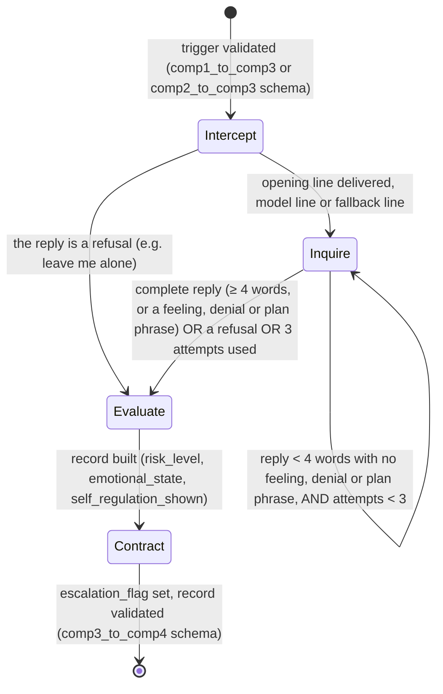

# Component 3 - FSM State Diagram

**Transition conditions, explicit** (`src/fsm_controller.py`, `src/config.py`):
- Start → Intercept: the trigger is validated against its source's schema first.
- Intercept → Inquire: after one opening line, unless the child's reply is a refusal (`emotion_rules.is_refusal`: "leave me alone", "I don't want to talk", "stop asking"...), which goes straight to Evaluate. How that line is made (model, or fallback line) is in [intercept-generation-path.md](intercept-generation-path.md).
- Inquire loop: `MIN_RESPONSE_WORDS_FOR_COMPLETENESS = 4`, `MAX_INQUIRE_ATTEMPTS = 3`. A shorter reply is still complete when it fires a distress, defensive or reflective phrase (`emotion_rules.states_something`), e.g. "I feel sick". INQUIRE lines are fixed templates until after PP1, picked by the reply type of the child's latest reply (`emotion_rules.reply_type`): a stated emotion gets a supportive line, "I don't know" a low-pressure one, anything else a neutral one (`INQUIRE_LINES` in `src/grammar_decoder.py`).
- Evaluate: `risk_level` comes from the detector's confidence: high if confidence ≥ 0.85, moderate if ≥ 0.5, otherwise low. `emotional_state` comes from the rule-based classifier (`src/emotion_rules.py`), `self_regulation_shown` from keywords such as "instead" and "next time".
- Contract → Done: escalates to a parent if `risk_level` is in `ESCALATION_RISK_LEVELS` (`{"high"}`), otherwise closes normally; a child whose last reply was a refusal hears "That's okay, you don't have to talk right now. I'm here if you want to talk later." Then `dialogue_turns` is counted and the record is validated against `comp3_to_comp4.schema.json` before it leaves Component 3.
