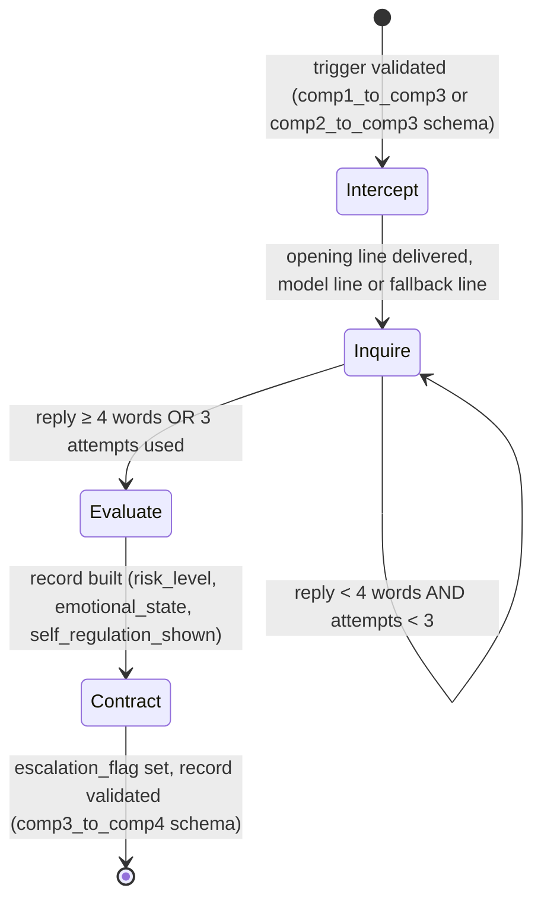

# Component 3 - FSM State Diagram

**Transition conditions, explicit** (`src/fsm_controller.py`, `src/config.py`):
- Start → Intercept: the trigger is validated against its source's schema first.
- Intercept → Inquire: always, after one opening line. How that line is made (model, or fallback line) is in [intercept-generation-path.md](intercept-generation-path.md).
- Inquire loop: `MIN_RESPONSE_WORDS_FOR_COMPLETENESS = 4`, `MAX_INQUIRE_ATTEMPTS = 3`. INQUIRE lines are fixed templates until after PP1.
- Evaluate: `risk_level` comes from the detector's confidence: high if confidence ≥ 0.85, moderate if ≥ 0.5, otherwise low. `emotional_state` comes from the rule-based classifier (`src/emotion_rules.py`), `self_regulation_shown` from keywords such as "instead" and "next time".
- Contract → Done: escalates to a parent if `risk_level` is in `ESCALATION_RISK_LEVELS` (`{"high"}`), otherwise closes normally. Then `dialogue_turns` is counted and the record is validated against `comp3_to_comp4.schema.json` before it leaves Component 3.
