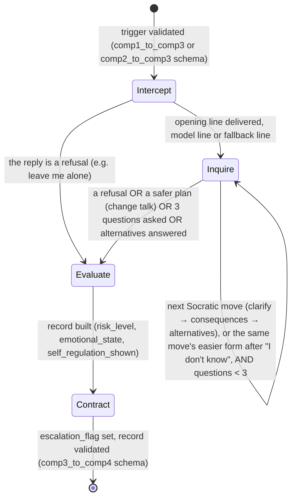

# Component 3 - FSM State Diagram

**Transition conditions, explicit** (`src/fsm_controller.py`, `src/config.py`):
- Start → Intercept: the trigger is validated against its source's schema first.
- Intercept → Inquire: after one opening line, unless the child's reply is a refusal (`emotion_rules.is_refusal`: "leave me alone", "I don't want to talk", "stop asking"...), which goes straight to Evaluate. How that line is made (model, or fallback line) is in [intercept-generation-path.md](intercept-generation-path.md).
- Inquire loop (since 26 Oct, ticket 03): the Socratic moves `SOCRATIC_MOVES = ("clarify", "consequences", "alternatives")` in that order, `MAX_INQUIRE_MOVES = 3` questions at most. A refusal ends INQUIRE at once; a safer plan in the child's own words ends it after the move it answers (the injected assessor labels the reply's stance as change talk); "I don't know" (`emotion_rules.is_dont_know`) asks the same move once more in its easier form, and that repeat counts toward the cap. Each line is a pre-checked template for the move and the age band (`INQUIRE_TEMPLATES` in `src/grammar_decoder.py`; bands `AGE_BANDS = ("8-10", "11-13", "14-15")`, a missing or invalid band means 8-10). Every transcript turn records its state, move, band, line source and fallback reason.
- Evaluate: `risk_level` comes from the detector's confidence: high if confidence ≥ 0.85, moderate if ≥ 0.5, otherwise low. `emotional_state` and `self_regulation_shown` come from the injected session assessor (`src/assessor.py`): it labels each child reply's expressed emotion, distress severity and stance (`src/codebook.py`), and one shared derivation gives distressed for any current distress, otherwise the dominant stance (defensive, unclear or calm; ADR 0006). `self_regulation_shown` is still keywords such as "instead" and "next time" (ticket 04 replaces it).
- Contract → Done: escalates to a parent if `risk_level` is in `ESCALATION_RISK_LEVELS` (`{"high"}`) or `emotional_state` is in `ESCALATION_EMOTIONAL_STATES` (`{"distressed"}`), whatever the risk level (since 14 Oct); the reason is appended to `dialogue_summary` ("escalated: risk_level=high" or "escalated: emotional_state=distressed"), otherwise closes normally; a child whose last reply was a refusal hears "That's okay, you don't have to talk right now. I'm here if you want to talk later." Then `dialogue_turns` is counted and the record is validated against `comp3_to_comp4.schema.json` before it leaves Component 3.
