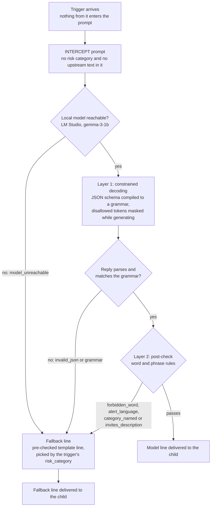

# Component 3 - INTERCEPT Generation Path (two layers + fallback line)

How the opening line a child sees is produced (`src/grammar_decoder.py`). Every path ends in a line that met both layers, or in a pre-checked fallback line.

**What each layer guarantees**
- **Layer 1, constrained decoding** (structure): the opener is one of two fixed safe openers; the question is one plain sentence (letters, spaces, commas, straight apostrophes) of at most 100 characters ending in `?`. The model cannot produce anything else.
- **Layer 2, post-check** (words a grammar cannot forbid): forbidden words; words that reveal an alert (`alert`, `flagged`, `warning`, ...); any risk-category word; questions inviting the child to describe the content ("What did you see?").
- **Fallback line**: a template line that passes both layers, used for any failure, including no model.

**Limitation:** the layers guarantee structure and banned words, not meaning. A reworded invitation can pass both (12 Oct end-to-end online run: "What's on your screen right now?" was blocked, "What's happening on your screen right now?" passed).

**Evidence** (`component3_socratic_educator/evidence/`)

| Run (date run) | Files | Result |
|---|---|---|
| 16 samples before/after (6 Oct before, 11 Oct after) | `intercept_samples_2026-10-06.jsonl`, `intercept_samples_constrained_2026-10-11.*` | grammar match 0/16 → 16/16; alert leaks 4/16 → 0/16 |
| 24 adversarial attacks (11 Oct) | `adversarial_intercept_2026-10-11*.summary.json` | 0/24 rule violations delivered; 5 blocked by the post-check after the fix |
| End-to-end, online (12 Oct) | `end_to_end_2026-10-12_online.*` | 7/8 model lines delivered, 1 blocked live (`invites_description`) |
| End-to-end, offline (12 Oct) | `end_to_end_2026-10-12_offline.*` | 8/8 fallback lines (`model_unreachable`), sessions complete |
