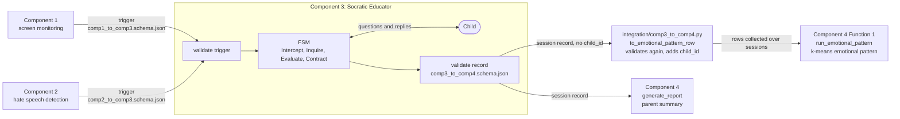

# System Data Flow - Component 1/2 → Component 3 → Component 4

One Python process, in-process calls, dicts shaped by the schemas in `docs/interface-contracts/`. `integration/end_to_end_pipeline.py` (`run_session`) runs each session up to the adapter row and the report; `component3_socratic_educator/evidence/run_end_to_end.py` then passes the collected rows to Component 4 Function 1.

**What is real and what is not yet** (as of the 12 Oct end-to-end run, `evidence/end_to_end_2026-10-12_*/`)

| Part | Status |
|---|---|
| Component 1, 2 triggers | Mock fixtures in the demo run. Component 2's real engine needs Hugging Face model downloads, unavailable offline. |
| Component 3 FSM, constrained INTERCEPT, record validation | Real. See [fsm-state-diagram.md](fsm-state-diagram.md) and [intercept-generation-path.md](intercept-generation-path.md). |
| Adapter (`to_emotional_pattern_row`) | Real. `child_id` is a device placeholder (one device = one child profile). |
| Component 4 Function 1 (`run_emotional_pattern`) | Real code. Its trained artifacts (`component4_profiling_xai/models/`) are gitignored, so each machine needs a copy or a rerun of Component 4's notebook. |
| Component 4 `generate_report` | Stub: formats the record as a parent summary. |
| Component 4 Function 2 (behavioral anomaly) | Not on this path: reads no Component 3 fields. |

**Interface gap:** the `comp3_to_comp4` schema has no `child_id`, which Function 1 groups by. The adapter adds it; the group decision is logged in `docs/interface-contracts/CHANGELOG.md` (2026-10-11).
